VERDICT: APPROVED

# RH-202 QA report

Verified on branch `meridian/RH-202` (HEAD `b0e544d`). Ran a live system: a throwaway Postgres database `rh202_qa` on the local cluster (:54322), all migrations applied with `scripts/migrate.mjs`, and `next dev --webpack` on :3902 with `BILLING_ENFORCED=true` and `BILLING_PROVIDER` unset (so the mock adapter was active). Turbopack refused to start because the worktree's `node_modules` is a symlink outside the worktree root, so I used webpack. The database was dropped afterwards.

```mermaid
flowchart LR
  A["Sign up + fast login: pass"] --> B["/settings first load"]
  B --> C["Lazy 14-day trial row: pass"]
  C --> D["Card: Pro Trial, 14 days remaining, Upgrade to Pro: pass"]
  D --> E["Click Upgrade: startCheckoutAction"]
  E --> F["/mock-checkout?session_id=mock_cs_monthly_uid: pass"]
  F --> G["Simulate Successful Checkout"]
  G --> H["Row pro/active, period end +1 month: pass"]
  H --> I["Card: Pro Active, Renews Dec 16 2026, Manage Subscription: pass"]
  I --> J["POST webhook subscription.canceled: 200, row canceled at period end: pass"]
```

## Technical Criteria Checked
- [x] TC-1: verified with `subscriptionsMigration.db.test.ts` (RUN_DB_TESTS=1, 12/12 pass) and by inspecting the live migrated DB. The table has columns `user_id` uuid NOT NULL; `plan` defaulting to 'free' with CHECK IN ('free','pro'); `status` defaulting to 'active' with CHECK IN ('trialing','active','past_due','canceled'); nullable timestamptz `trial_ends_at` and `current_period_ends_at`; `cancel_at_period_end`; `provider` defaulting to 'mock'; `provider_customer_id`; and `provider_subscription_id`. It has constraints `UNIQUE (user_id)` and `FOREIGN KEY (user_id) REFERENCES profiles(id) ON DELETE CASCADE`. The tests confirm `plan:band` and `status:paused` are rejected and every allowed value is accepted.
- [x] TC-2: `subscriptions.test.ts` passes (18 tests): unset resolves to Pro without touching the DB, a missing row starts a 14-day trial, an expired trial resolves to Free, an active row resolves to Pro, and a canceled row stays Pro until the period end and becomes Free after. Live: the first `/settings` load with enforcement on inserted `pro/trialing`, trial_ends_at = now + 14 days (2026-11-30T16:24Z).
- [x] TC-3: `entitlements.test.ts` passes (11 tests): the Free and Pro objects match Scope §2 exactly, and the thresholds hold (49→true, 50→false charts; 1/2 fields; 4/5 offline songs; 2 GB guard; 1 GB audio). Code review confirms `FREE_ENTITLEMENTS` and `PRO_ENTITLEMENTS` match the spec.
- [x] TC-4: `mockBillingAdapter.test.ts` asserts all four methods exist. `npx tsc --noEmit` exits 0. `grep stripe|mercadopago|better-auth src/lib/billing/types.ts` finds nothing, and the types are neutral records.
- [x] TC-5: `mockBillingAdapter.test.ts` passes: the URL starts with `/mock-checkout?session_id=`, and completion sets pro/active with a future period end (monthly and annual). Live: the row became `pro/active`, `current_period_ends_at` 2026-12-16 (now + 1 month), with provider ids `mock_cus_<uid>` and `mock_sub_<uid>`.
- [x] TC-6: `billingActions.test.ts` passes (13 tests). `actionSessionGuard.test.ts` lists all five billing actions (`getSubscriptionStatusAction`, `startCheckoutAction`, `openCustomerPortalAction`, `completeMockCheckoutAction`, `cancelSubscriptionAction`) and they pass. Live: Upgrade invoked `startCheckoutAction("monthly")` and the browser landed on `/mock-checkout?session_id=mock_cs_monthly_5a650d8e-…`.
- [x] TC-7: `route.test.ts` passes (3 tests: raw body and headers forwarded, 200 `{received:true}`, 400 on rejection). Live POSTs to `/api/billing/webhook`:
  - `{"type":"ping"}` returned `200 {"received":true}`.
  - `{"type":"subscription.canceled","subscriptionId":"mock_sub_<uid>"}` returned `200 {"received":true}`, and the row changed to `status=canceled, cancel_at_period_end=true`. This shows the event reached the adapter.
  - `not json` returned `400 {"error":"Webhook could not be processed","code":400}`.
- [x] TC-8: `SubscriptionSettingsSection.test.tsx` passes (6 tests). Live Playwright on `/settings` showed both states:
  - Trial: "Pro Trial · 14 days remaining · Your 14-day trial includes every Pro feature until Nov 30, 2026." with the button "Upgrade to Pro — R$ 14,90/month".
  - After checkout: "Pro · Active · Renews on Dec 16, 2026." with the button "Manage Subscription".
  - The Free state was covered by the unit test only.
- [x] TC-9: `npx vitest run --coverage` exits 0: 338 files, 4148 passed, 3 skipped. Overall coverage is statements 97.11 / branches 90.75 / functions 96.97 / lines 97.81, above the 80/65/78/80 thresholds. `vitest.config.ts` is not in the diff, so the thresholds are unchanged. A targeted coverage run on the new modules (`subscriptions.ts`, `entitlements.ts`, `billing/**`, `subscriptionDisplay.ts`, `actions/billing.ts`) shows 100% on all four metrics. `npm run lint` exits 0 (checked through `&&`, not the rtk summary).

## Product Acceptance Criteria
- AC-1: PASS (TC-1)
- AC-2: PASS (TC-2, TC-3)
- AC-3: PASS (TC-4)
- AC-4: PASS (TC-5, TC-6)
- AC-5: PASS (TC-7)
- AC-6: PASS (TC-8)
- AC-7: PASS (TC-9)

## Expected Results Checked
- [x] `migrations/0032_subscriptions.sql` creates `subscriptions` with user_id, plan, status, period timestamps and provider ids. Verified by the DB test and by live `information_schema` and `pg_constraint` queries (see TC-1).
- [x] `getEntitlements(userId)` returns Pro limits until billing is enforced and the exact Free/Pro limits when enforced. Verified by unit tests (TC-2, TC-3) and by reading the code: `getEntitlements` is `entitlementsForPlan(resolveUserPlan().plan)`, and `resolveUserPlan` returns pro when `BILLING_ENFORCED !== 'true'`.
- [x] `PaymentAdapter` defines the four methods with no provider-specific types. Verified by reading `src/lib/billing/types.ts`, by grep, and with tsc (TC-4).
- [x] The default `MockPaymentAdapter` checkout points to `/mock-checkout` and its completion activates Pro with a future period end. Verified live end to end in the browser, with the DB row checked (TC-5, TC-6).
- [x] `POST /api/billing/webhook` dispatches to the active adapter and returns 200 `{received:true}`. Verified live with Node `fetch`; the cancel event changed the DB row (TC-7).
- [x] `/settings` shows plan and status with an "Upgrade to Pro" or "Manage Subscription" action. Verified live with Playwright in the trial and active states (TC-8). Screenshots were taken during the run and then removed from the worktree so they would not be committed.
- [x] `npm test` and `npm run lint` pass with the new modules covered and thresholds unchanged (TC-9).

## Registry lines checked
Area touched: **Auth and profile** (`node scripts/behavior.js area "Auth and profile"`).
- The existing lines on sign-up/sign-in, the proxy redirecting to /login, the proxy only checking cookie presence while actions resolve their own session, and the dev profiles endpoint all behaved as described live. Sign-up through `/api/auth/sign-up/email` returned 200. Sign-in through fast login worked. `/settings` without a valid session redirected to `/login?redirect=%2Fsettings`, and an auth page with a cookie redirected home. `/api/dev/profiles` returned the user list in development.
- The token, `/api/v1`, Spotify, email-change and password lines are outside the code this task changes. Their tests are in the full suite that passed. No regression was found.
- The three new RH-202 lines (Pro by default / entitlements; provider-agnostic payment layer with mock adapter; Settings plan display) were verified live as described above.

## Registry file check
`package.json` has no `test:registry` script, so this check was skipped.

## Blocking Findings
None.

## Suggestions
- `POST /api/billing/webhook` with the mock adapter is unauthenticated by design. Any caller can POST `checkout.completed` for `mock_cs_<interval>_<anyUserId>` to grant Pro, or `subscription.canceled` for `mock_sub_<userId>` to cancel someone else's subscription. I confirmed the cancel case live. `getPaymentAdapter()` refuses mock + enforced in production, which closes the grant-Pro hole there. A cancel through the mock webhook still works in production while billing is not enforced, but it has no effect because everyone resolves to Pro. Consider having the mock adapter reject webhooks when `NODE_ENV === 'production'`, or requiring a shared secret header.
- `planFromRecord` treats `status='active'` with a null `current_period_ends_at` as Pro indefinitely. This is harmless for the mock, which always sets a period end. A real adapter should always write one.
- Environment note, not a defect of this task: running `next dev` from a Meridian worktree fails under Turbopack (symlinked `node_modules` outside the root). Under webpack it rebuilds in a loop while Playwright writes `.playwright-mcp/` into the worktree, which also caused DB pool timeouts on unrelated sections (custom fields, Spotify).
