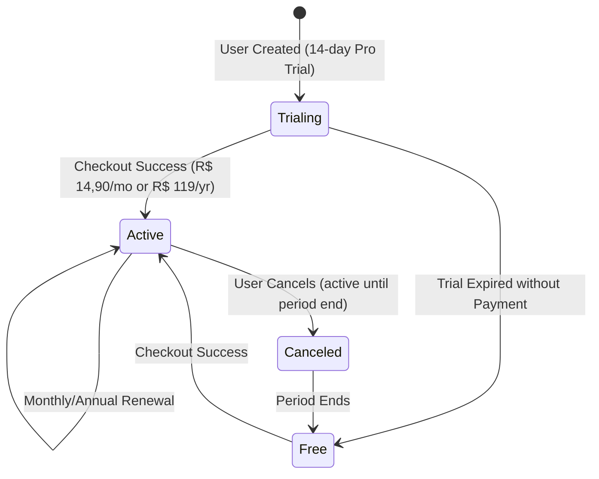

# RH-202 — Add a subscription layer with plans, entitlements and a mock payment adapter

Mockup: [`docs/tasks/RH-202-mock.html`](RH-202-mock.html) — interactive preview of Settings subscription states (Free, 14-day Trial, Active Pro) and the Mock Checkout view.

## Scope

Repertoire Hero is preparing to monetize by introducing a paid Pro plan alongside the Free tier. Per architectural decision (2026-11-16), Repertoire Hero stays on Neon PostgreSQL and Better Auth instead of moving to Supabase. This task implements the foundational, provider-agnostic subscription and entitlements layer, with a mock payment adapter so the subscription lifecycle can be tested end-to-end without coupling to a specific gateway.

This task covers:

1. **User Subscription Schema & Persistence**:
   - Migration `migrations/0032_subscriptions.sql` creating the `subscriptions` table with `user_id`, `plan` (`free` | `pro`), `status` (`trialing` | `active` | `past_due` | `canceled`), `trial_ends_at`, `current_period_ends_at`, `cancel_at_period_end`, `provider`, `provider_customer_id`, and `provider_subscription_id`.
   - Domain functions in `src/lib/subscriptions.ts` to fetch, upsert, and resolve user subscriptions.
   - Default resolution rule: **Until billing is enforced (or when `BILLING_ENFORCED !== 'true'`), every user resolves to Pro plan entitlements**, preserving full access during rollout and pre-launch.
   - When billing enforcement is enabled, new accounts receive a **14-day Pro trial** upon creation/first check.

2. **Central Entitlements Engine (`src/lib/entitlements.ts`)**:
   - Pure functions defining feature limits per plan:
     - **Free**: 50 chart files, 2 custom fields, no own audio (`maxAudioBytes: 0`, `allowOwnAudio: false`), no API/skill tokens (`allowApiTokens: false`), no continuous setlist player (`allowSetlistPlayer: false`), 5 offline songs per device (`maxOfflineSongsPerDevice: 5`), and no 1-click download all (`allowOfflineDownloadAll: false`).
     - **Pro**: Unlimited charts (`maxChartFiles: null`, protected by a 2 GB storage abuse guard `chartAbuseLimitBytes: 2147483648`), unlimited custom fields (`maxCustomFields: null`), 1 GB own audio storage (`maxAudioBytes: 1073741824`, `allowOwnAudio: true`), API/skill personal access tokens (`allowApiTokens: true`), continuous setlist player (`allowSetlistPlayer: true`), unlimited offline songs (`maxOfflineSongsPerDevice: null`), and 1-click download all (`allowOfflineDownloadAll: true`).
   - Query function `getEntitlements(userId: string): Promise<UserEntitlements>` returning effective limits based on resolved subscription status.
   - Verification helper predicates: `canUploadChart`, `canCreateCustomField`, `canUploadAudio`, `canCreateApiToken`, `canUseSetlistPlayer`, `canDownloadSongOffline`, and `canDownloadAllOffline`.

3. **Provider-Agnostic Payment Adapter Interface & Mock Adapter**:
   - Interface `PaymentAdapter` in `src/lib/billing/types.ts` defining:
     - `createCheckoutSession(params: CheckoutSessionParams): Promise<CheckoutSessionResult>`
     - `createCustomerPortalSession(params: CustomerPortalParams): Promise<CustomerPortalResult>`
     - `handleWebhook(rawBody: string | Buffer, headers: Record<string, string | string[] | undefined>): Promise<WebhookResult>`
     - `cancelSubscription(subscriptionId: string): Promise<void>`
   - `MockPaymentAdapter` in `src/lib/billing/mockAdapter.ts`:
     - Generates simulated checkout sessions pointing to `/mock-checkout?session_id=...`.
     - Supports simulating successful checkouts by transitioning the user's subscription to active Pro (monthly at R$ 14,90 or annual at R$ 119).
     - Provides customer portal redirect and cancellation simulation.
   - Factory in `src/lib/billing/index.ts` returning `MockPaymentAdapter` when `BILLING_PROVIDER` is unset or `'mock'`.

4. **Billing Routes & Server Actions**:
   - Server Actions in `src/app/actions/billing.ts`: `startCheckoutAction`, `openCustomerPortalAction`, and `getSubscriptionStatusAction`.
   - Provider-agnostic webhook Route Handler at `POST /api/billing/webhook` forwarding payload to the configured `PaymentAdapter`.
   - Standalone dev/test checkout page at `src/app/mock-checkout/page.tsx` allowing developers/testers to trigger mock checkout completion or cancellation.

5. **Settings UI Integration**:
   - `SubscriptionSettingsSection` component mounted in `/settings` (`src/app/settings/page.tsx`), showing current plan badge (Free, Pro Trial, Pro Active), trial remaining or renewal date, and actions to upgrade or manage billing.

Explicitly out of scope:
- Specific third-party payment gateway SDK integrations (Stripe, Mercado Pago) — delegated to dedicated provider adapter tasks.
- In-place gating/blocking in existing upload forms, custom field editors, audio managers, token generators, and setlist players (wiring checks into each feature is handled in follow-up tasks).
- Band-level subscription tiers and band-member entitlement pooling (still undecided in domain model).

## Approach

### Data Model & Resolution

The migration adds a `subscriptions` table with one row per user:

- `user_id` — uuid, not null, unique, references `profiles(id)` with `ON DELETE CASCADE`.
- `plan` — text, not null, default `free`, CHECK restricted to `free`, `pro`.
- `status` — text, not null, default `active`, CHECK restricted to `trialing`, `active`, `past_due`, `canceled`.
- `trial_ends_at`, `current_period_ends_at` — nullable `timestamptz`.
- `cancel_at_period_end` — boolean, not null, default false.
- `provider` — text, not null, default `mock`; `provider_customer_id`, `provider_subscription_id` — nullable text.
- `id` (uuid primary key), `created_at`, `updated_at` as in the other tables.

When evaluating `resolveUserPlan(userId)`:
- If `process.env.BILLING_ENFORCED !== 'true'`, return `{ plan: 'pro', status: 'active', isEnforced: false }`.
- If `BILLING_ENFORCED === 'true'`:
  - If a subscription record exists:
    - If `status === 'trialing'`, evaluate `trial_ends_at`: active Pro while `now() < trial_ends_at`, else expired (Free).
    - If `status === 'active'`, Pro plan is effective until `current_period_ends_at`.
    - If `status === 'canceled'`, Free plan unless still within `current_period_ends_at` with `cancel_at_period_end = true`.
  - If no subscription record exists: lazily initialize a 14-day Pro trial (`status: 'trialing', trial_ends_at: now() + 14 days`).

### Provider-Agnostic Architecture & Payment Service

The payment interface lives in `src/lib/billing/types.ts`:

- `PaymentAdapter` defines methods taking and returning neutral TypeScript records. No vendor webhook signature classes or SDK client types cross this boundary.
- `MockPaymentAdapter` implements this contract:
  - `createCheckoutSession` creates a deterministic mock session token and returns `{ url: '/mock-checkout?session_id=...' }`.
  - In `src/app/mock-checkout/page.tsx`, submitting "Simulate Success" updates the user's `subscriptions` row to `plan: 'pro', status: 'active', current_period_ends_at: now() + 1 month` and redirects to the success URL.
- `src/lib/billing/index.ts` provides `getPaymentAdapter()`. When other providers are added in the future, switching adapters only requires setting `BILLING_PROVIDER=stripe` or `BILLING_PROVIDER=mercadopago`.

### Files Touched

- `migrations/0032_subscriptions.sql` (new) — creates `subscriptions` table and unique constraint/indexes.
- `src/types/database.ts` — defines `SubscriptionPlan`, `SubscriptionStatus`, and `SubscriptionRecord` interfaces.
- `src/lib/subscriptions.ts` (new) — CRUD and plan resolution logic for subscriptions.
- `src/lib/entitlements.ts` (new) — plan limit constants, `getEntitlements`, and feature permission check helpers.
- `src/lib/billing/types.ts` (new) — provider-agnostic payment adapter interfaces and session types.
- `src/lib/billing/mockAdapter.ts` (new) — mock adapter implementation for dev/test flows.
- `src/lib/billing/index.ts` (new) — billing service adapter resolver based on `BILLING_PROVIDER`.
- `src/app/actions/billing.ts` (new) — Server Actions for starting checkout, opening customer portal, and fetching subscription state.
- `src/app/billingActions.ts` (new) — exports `BILLING_SETTINGS_ACTIONS` bundle for client injection into `SubscriptionSettingsSection` (F21 import-direction convention).
- `src/app/api/billing/webhook/route.ts` (new) — provider-agnostic webhook endpoint.
- `src/app/mock-checkout/page.tsx` (new) — dev/test checkout simulator page.
- `src/components/settings/SubscriptionSettingsSection.tsx` (new) — Settings subscription card displaying plan details and actions (receives `BILLING_SETTINGS_ACTIONS`).
- `src/app/settings/page.tsx` — mounts `SubscriptionSettingsSection`.
- `src/lib/__tests__/subscriptionsMigration.db.test.ts` (new) — DB test applying `0032_subscriptions.sql` and asserting table, columns and CHECK constraints (follows the existing `*Migration.db.test.ts` pattern).
- `src/app/api/billing/webhook/__tests__/route.test.ts` (new) — route handler test for the webhook endpoint.
- `src/components/settings/__tests__/SubscriptionSettingsSection.test.tsx` (new) — render test for the three plan states.
- `src/lib/__tests__/subscriptions.test.ts` (new) — unit tests for subscription resolution and trial expiration.
- `src/lib/__tests__/entitlements.test.ts` (new) — unit tests for plan limits and entitlement check functions.
- `src/lib/__tests__/mockBillingAdapter.test.ts` (new) — unit tests for mock checkout and portal sessions.
- `src/app/actions/__tests__/billingActions.test.ts` (new) — unit tests for billing Server Actions.
- `src/app/actions/__tests__/actionSessionGuard.test.ts` — adds `FAIL_CLOSED` entries for the new billing Server Actions.
- `docs/behavior.md` — records added subscription, entitlement, and settings behavior lines.

Test criteria are listed under `## Technical Criteria` below.

## Behavior changes

- added: Auth and profile — A user resolves to Pro plan entitlements by default until billing is enforced; when billing is enabled, plan entitlements govern limits for charts, custom fields, audio uploads, API tokens, setlist player, and offline downloads. (src/lib/subscriptions.ts, src/lib/entitlements.ts) (RH-202)
- added: Auth and profile — The payment layer abstracts billing providers behind a common interface with an initial mock adapter supporting checkout sessions, customer portal URLs, and webhook handling. (src/lib/billing/types.ts, src/lib/billing/mockAdapter.ts) (RH-202)
- added: Auth and profile — Settings displays the user's subscription tier, trial status, and renewal period with actions to upgrade or manage billing. (src/components/settings/SubscriptionSettingsSection.tsx, src/app/settings/page.tsx) (RH-202)

## Acceptance Criteria

- [ ] **AC-1** — Each user's plan state (plan, status, trial end, period end, provider ids) is stored in a `subscriptions` table created by `migrations/0032_subscriptions.sql`.
- [ ] **AC-2** — A single entitlements check tells every feature what a user may do: Pro for everyone until billing is enforced, and the decided Free and Pro limits once it is.
- [ ] **AC-3** — The payment layer is one provider-agnostic interface, so a real provider can be added later without touching the rest of the app.
- [ ] **AC-4** — With the default mock provider, a user can go through checkout end to end and end up on an active Pro subscription.
- [ ] **AC-5** — Payment events posted to `/api/billing/webhook` reach the configured provider adapter and are acknowledged.
- [ ] **AC-6** — The Settings page shows the user's plan and status with an "Upgrade to Pro" or "Manage Subscription" action.
- [ ] **AC-7** — The project's test and lint gates stay green with the new code covered.

## Technical Criteria

- [ ] **TC-1** → AC-1 — `src/lib/__tests__/subscriptionsMigration.db.test.ts` passes: after applying `0032_subscriptions.sql` the `subscriptions` table has `user_id` (unique, FK to `profiles`), `plan`, `status`, `trial_ends_at`, `current_period_ends_at`, `cancel_at_period_end`, `provider`, `provider_customer_id`, `provider_subscription_id`; inserting `plan = 'band'` or `status = 'paused'` is rejected by the CHECK constraints, and every allowed `plan`/`status` value is accepted.
- [ ] **TC-2** → AC-2 — `src/lib/__tests__/subscriptions.test.ts` passes: with `BILLING_ENFORCED` unset the user resolves to Pro; with it `'true'` a user without a row gets a 14-day trial, an expired trial resolves to Free, an active row resolves to Pro, and a canceled row resolves to Pro until `current_period_ends_at` and Free after.
- [ ] **TC-3** → AC-2 — `src/lib/__tests__/entitlements.test.ts` passes: Free and Pro limit objects equal the exact values in Scope §2, and each `can*` predicate returns true just under and false at its Free threshold.
- [ ] **TC-4** → AC-3 — `src/lib/__tests__/mockBillingAdapter.test.ts` asserts `MockPaymentAdapter` implements all four `PaymentAdapter` methods, and `npx tsc --noEmit` passes; `src/lib/billing/types.ts` imports no provider package (`stripe`, `mercadopago`, `@better-auth/stripe`).
- [ ] **TC-5** → AC-4 — `src/lib/__tests__/mockBillingAdapter.test.ts` passes: `createCheckoutSession` returns a URL starting with `/mock-checkout?session_id=`, and completing that session sets the row to `plan = 'pro'`, `status = 'active'` with `current_period_ends_at` in the future.
- [ ] **TC-6** → AC-4 — `src/app/actions/__tests__/billingActions.test.ts` passes (signed-in `startCheckoutAction` returns the mock checkout URL) and `actionSessionGuard.test.ts` lists the new billing actions as `FAIL_CLOSED` and passes.
- [ ] **TC-7** → AC-5 — `src/app/api/billing/webhook/__tests__/route.test.ts` passes: `POST` calls the active adapter's `handleWebhook` with the raw body and headers and answers `200` with `{ "received": true }`.
- [ ] **TC-8** → AC-6 — `src/components/settings/__tests__/SubscriptionSettingsSection.test.tsx` passes: Free shows "Upgrade to Pro", Trial shows the days remaining, Active Pro shows the renewal date and "Manage Subscription".
- [ ] **TC-9** → AC-7 — `npm test` (with coverage thresholds) and `npm run lint` exit 0.

## Expected Results

- [ ] `migrations/0032_subscriptions.sql` creates `subscriptions` with `user_id`, `plan` (free, pro), `status` (trialing, active, past_due, canceled), period timestamps and provider identifiers.
- [ ] `getEntitlements(userId)` returns Pro limits until billing is enforced, and the exact Free and Pro limits of Scope §2 when enforced.
- [ ] `PaymentAdapter` defines `createCheckoutSession`, `createCustomerPortalSession`, `handleWebhook` and `cancelSubscription` with no provider-specific types.
- [ ] The default `MockPaymentAdapter` checkout points to `/mock-checkout` and its completion activates a Pro subscription with a future period end.
- [ ] `POST /api/billing/webhook` dispatches to the active adapter and returns `200` with `{ received: true }`.
- [ ] `/settings` shows the user's plan and status with an "Upgrade to Pro" or "Manage Subscription" action.
- [ ] `npm test` and `npm run lint` pass with the new modules covered and coverage thresholds unchanged.

## Operator Results Coverage

| Operator result | Spec section | Returned result |
|---|---|---|
| 1. Migration `0032_subscriptions.sql` | Scope §1, Approach "Data Model", TC-1 | ER 1 |
| 2. `getEntitlements` limits | Scope §2, TC-2, TC-3 | ER 2 |
| 3. `PaymentAdapter` interface | Scope §3, TC-4 | ER 3 |
| 4. `MockPaymentAdapter` checkout | Scope §3–4, TC-5, TC-6 | ER 4 |
| 5. Webhook `200 { received: true }` | Scope §4, TC-7 | ER 5 |
| 6. Settings plan display | Scope §5, mock, TC-8 | ER 6 |
| 7. `npm test` / `npm run lint` | TC-9 | ER 7 |

## Provider Architecture and Future Considerations

This task leaves the selection of the production payment gateway open for a subsequent adapter task, while guaranteeing zero lock-in:

1. **Stripe**:
   - *Pros*: Official Better Auth Stripe plugin (`@better-auth/stripe`), battle-tested recurring subscriptions, robust Customer Portal out of the box, standard developer experience. Supports credit card recurring billing and Pix one-off payments (suitable for annual plans).
   - *Cons*: Pix recurring is not natively supported in Brazil (requires card for monthly auto-renew).
2. **Mercado Pago**:
   - *Pros*: High brand recognition and trust in Brazil; ubiquitous Pix payment support.
   - *Cons*: Recurring subscriptions via Pix remain operationally complex / inconsistent; SDK integration with Better Auth is custom.
3. **Neutral Boundary**:
   - By encapsulating checkout URL creation, customer portal redirection, and webhook parsing inside `PaymentAdapter`, the rest of the application remains completely insulated from the chosen provider.

## Out of Scope

- Integrating production Stripe or Mercado Pago API credentials and SDKs.
- Blocking enforcement logic inside existing upload forms, custom field forms, audio ingestion, API token generation, and setlist player components (these will check `getEntitlements` in follow-up wiring tasks).
- Band subscription tier and band-member shared entitlements.
